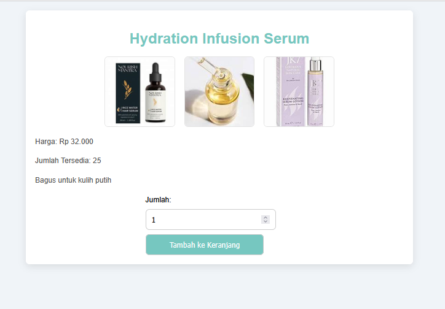
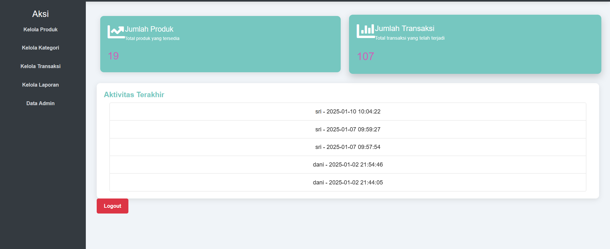
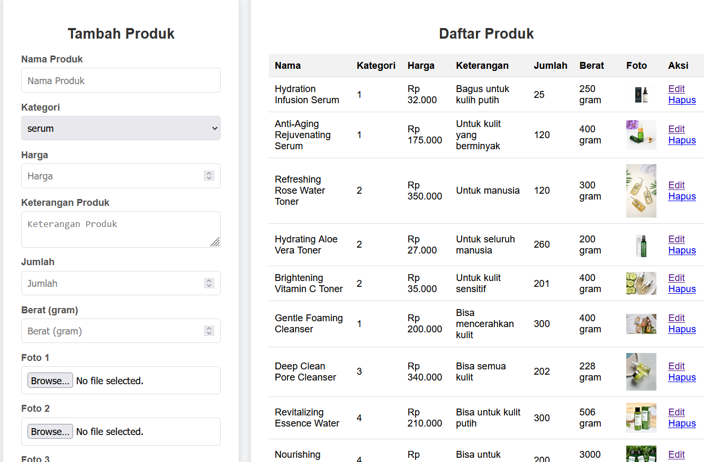

# 🛒 Sistem E-Commerce "Sri Glow Skincare"

## 📌 Deskripsi Proyek
Sebuah platform E-Commerce berbasis web yang dirancang khusus untuk digitalisasi penjualan dan pemasaran produk kecantikan serta perawatan kulit "Sri Glow Skincare". Proyek ini dikembangkan pada Semester 5 sebagai bentuk implementasi dari mata kuliah Ecommerce.

Sistem ini dibangun untuk memberikan pengalaman berbelanja yang mudah, interaktif, dan responsif bagi pelanggan dalam menjelajahi katalog produk kecantikan hingga melakukan transaksi secara online.

> ⚠️ **DISCLAIMER / CATATAN HAK CIPTA:**  
> Seluruh foto produk, nama produk, dan aset merek yang digunakan di dalam proyek ini sepenuhnya milik pemegang hak cipta masing-masing. Aset tersebut digunakan murni sebagai data simulasi akademis (*dummy data*) untuk keperluan ilustrasi fungsi sistem (katalog dan keranjang belanja) dalam lingkup pendidikan, serta **TIDAK** digunakan untuk tujuan komersial atau mencari keuntungan.

## 🎯 Fitur Utama
- **Katalog Produk Interaktif**: Menampilkan seluruh daftar produk kecantikan yang terbagi berdasarkan kategori (seperti Skincare, Bodycare, Serum, dll).
- **Manajemen Keranjang Belanja (Cart)**: Memungkinkan pelanggan untuk menambah, mengurangi, atau menghapus item produk sebelum melakukan checkout.
- **Sistem Transaksi Pemesanan**: Formulir pembelian ringkas beserta perhitungan otomatis total harga barang dan biaya belanja.
- **Autentikasi & Multiuser**: Sistem login dan registrasi terpisah untuk menjaga keamanan data pelanggan.
- **Panel Admin (Content Management)**: Halaman khusus bagi pengelola toko untuk memanajemen stok barang, memperbarui harga produk, serta memantau pesanan masuk.

## 🛠️ Tech Stack
- **Frontend**: HTML5, CSS3, JavaScript, Bootstrap (Responsive Design)
- **Backend**: PHP 
- **Database**: MySQL

## 📸 Screenshot Sistem
### Halaman Utama & Katalog Produk

### Detail Produk & Keranjang Belanja

### Halaman Admin (Manajemen Produk)

## 👤 Developer
**Sri Ramadhani**  
S1 Informatika — Universitas Almuslim  
📧 sriramadani596@gmail.com

